# Data Warehouse con arquitectura Medallón en SQL Server

Integración de un CRM y un ERP: Bronze, Silver, Gold y orquestación con SQL Server Agent

Álvaro García-Quismondo Lizana · Máster en IA y Big Data · Tajamar · 19 de octubre de 2026

## 1. Objetivo y entorno

En esta práctica construyo un Data Warehouse sencillo en SQL Server a partir de dos sistemas origen entregados como ficheros CSV: un CRM (clientes, productos y líneas de venta) y un ERP (datos demográficos, país y catálogo de categorías). Sigo la arquitectura Medallón: una capa Bronze que guarda los datos tal como llegan, una capa Silver donde se limpian y estandarizan, y una capa Gold con un modelo en estrella listo para el análisis. Al final programo la carga diaria con SQL Server Agent y respondo a las preguntas de negocio sobre la capa Gold.

| Elemento | Valor |
|---|---|
| Servidor | SQL Server 2025 (17.0 RTM), Standard Developer Edition, instancia por defecto T07W02 |
| Herramienta | SQL Server Management Studio 22 |
| Base de datos | `DataWarehouse`, con un esquema por capa: `bronze`, `silver` y `gold` |
| Ficheros origen | `C:\sql\dwh_project\datasets\source_crm` y `source_erp` |

Los CSV se descargaron en la carpeta de Descargas y se copiaron a la ruta que esperan los procedimientos con un script de PowerShell (`sql/00_crear_estructura.ps1`). Todos los scripts SQL están numerados en la carpeta `sql/` en el mismo orden en que los ejecuté.

## 2. Base de datos y esquemas

El script `01_init_database.sql` elimina la base de datos si ya existe y la vuelve a crear con los tres esquemas. Cada `CREATE SCHEMA` va en su propio lote (`GO`) porque debe ser la primera instrucción del lote.

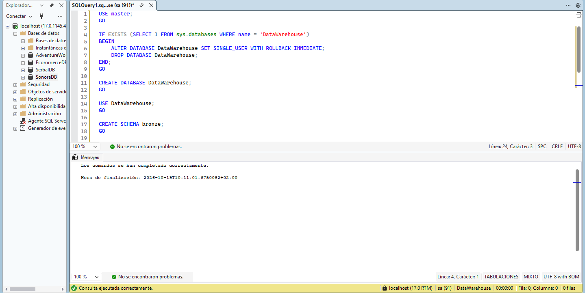

*Figura 1. Ejecución del script de creación de la base de datos y los esquemas.*

Tras actualizar el Explorador de objetos aparecen los esquemas `bronze`, `silver` y `gold` dentro de `Seguridad > Esquemas`.

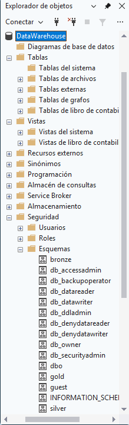

*Figura 2. Esquemas de la base de datos DataWarehouse.*

## 3. Capa Bronze

### 3.1 Tablas

Las seis tablas Bronze reproducen las columnas del origen con tipos que aceptan los valores tal como vienen: las fechas de ventas se guardan como `INT` porque llegan como `20101229` y algunas valen `0`, y las fechas de producto como `DATETIME`. Cada tabla va precedida de un `IF OBJECT_ID(...) IS NOT NULL DROP TABLE` para que el script se pueda repetir.

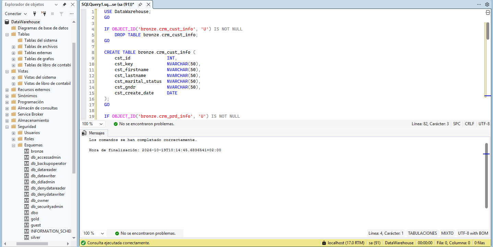

*Figura 3. Creación de las tablas Bronze.*

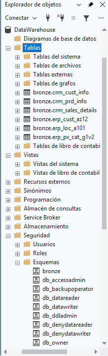

*Figura 4. Tablas Bronze en el Explorador de objetos.*

### 3.2 Carga manual de prueba

Antes de automatizar cargué solo `crm_cust_info` con `BULK INSERT` para entender las opciones: `TRUNCATE` previo para no duplicar en una recarga, `FIRSTROW = 2` para saltar la cabecera, `FIELDTERMINATOR = ','` y `TABLOCK` para acelerar la carga.

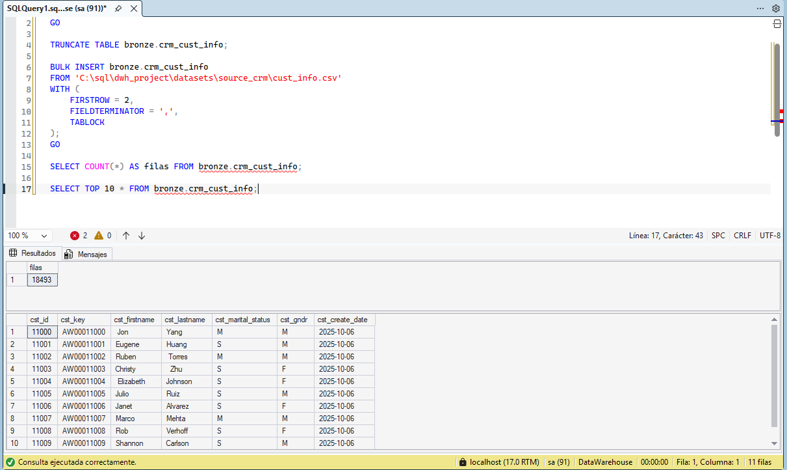

*Figura 5. Carga manual de crm_cust_info y revisión de las primeras filas.*

Cada valor cae en su columna (nombre, apellido, estado civil, género y fecha de alta), así que el separador y el número de columnas son correctos. Ya en esta vista se aprecian espacios sobrantes en algunos nombres, como ` Zhu` o ` Elizabeth`, que se tratarán en Silver.

### 3.3 Procedimiento bronze.load_bronze

Las seis cargas quedan empaquetadas en el procedimiento `bronze.load_bronze`, con mensajes `PRINT` para seguir el progreso, la duración de cada tabla y del lote, y un bloque `TRY...CATCH`. Respecto al script original añadí `THROW;` al final del `CATCH`; sin esa línea el procedimiento captura el error y termina aparentemente bien, y SQL Server Agent no podría detectar una carga fallida (sección 6).

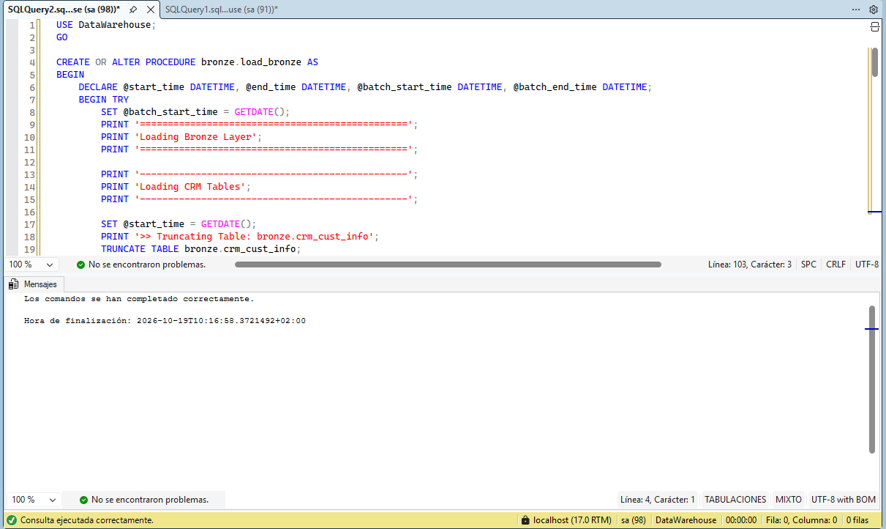

*Figura 6. Creación del procedimiento bronze.load_bronze.*

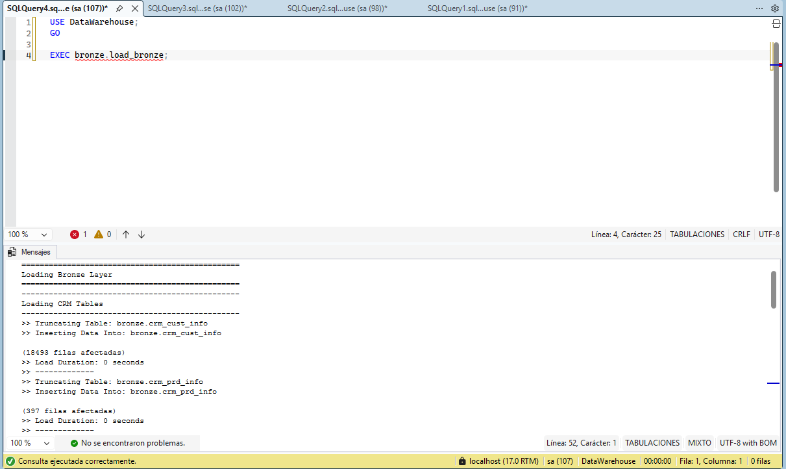

*Figura 7. Mensajes de la ejecución de bronze.load_bronze.*

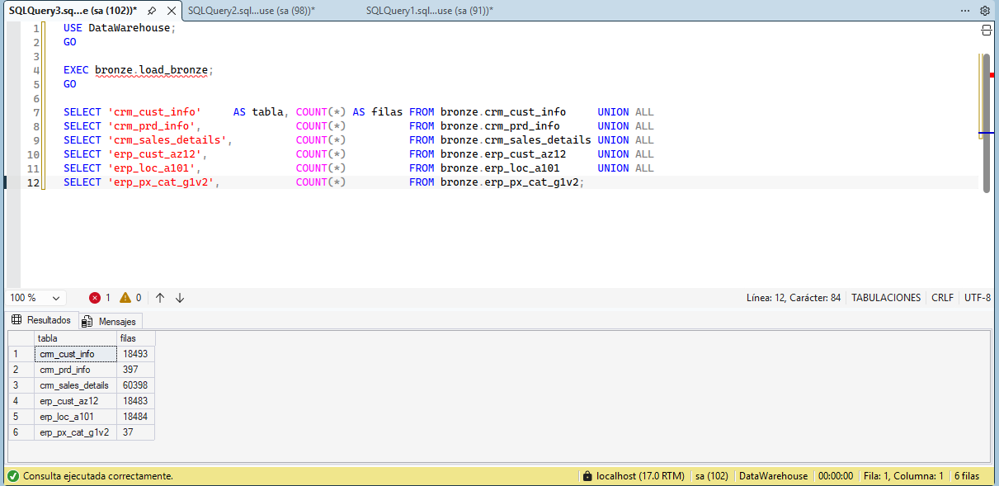

*Figura 8. Recuento de filas cargadas en cada tabla Bronze.*

| Tabla | Enunciado | Obtenido |
|---|---|---|
| crm_cust_info | 18.494 | 18.493 |
| crm_prd_info | 397 | 397 |
| crm_sales_details | 60.398 | 60.398 |
| erp_cust_az12 | 18.484 | 18.483 |
| erp_loc_a101 | 18.484 | 18.484 |
| erp_px_cat_g1v2 | 37 | 37 |

> Dos tablas tienen una fila menos que en el enunciado. No es un fallo de la carga, sino de la versión de los CSV: en `crm_cust_info` el grupo de clientes sin identificador tiene 3 filas en lugar de 4 (figura 10), y esas filas se descartan en Silver de todos modos. Como se verá más adelante, todas las cifras de Silver y Gold coinciden con las del enunciado.

## 4. Capa Silver

En Silver seguí el mismo método para cada tabla: detectar el problema con una consulta sobre Bronze, transformarlo con SQL y comprobar que la consulta de detección deja de devolver filas.

### 4.1 Tablas

Las tablas Silver son casi iguales que las de Bronze, con tres cambios: las fechas pasan a `DATE`, `crm_prd_info` incorpora la columna derivada `cat_id` para enlazar con el ERP, y todas reciben la columna técnica `dwh_create_date` con `DEFAULT GETDATE()`.

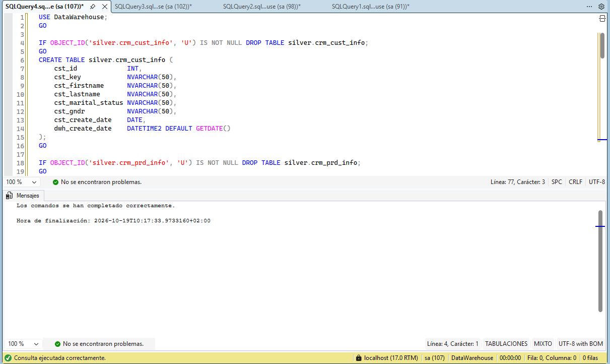

*Figura 9. Creación de las tablas Silver.*

### 4.2 Detección de problemas en Bronze

La clave de clientes no es única: hay 5 clientes duplicados y un grupo de filas con `cst_id` nulo. En el cliente 29466 se ve que la versión más reciente es la más completa, así que la regla será quedarse con la fila de `cst_create_date` más reciente por cliente.

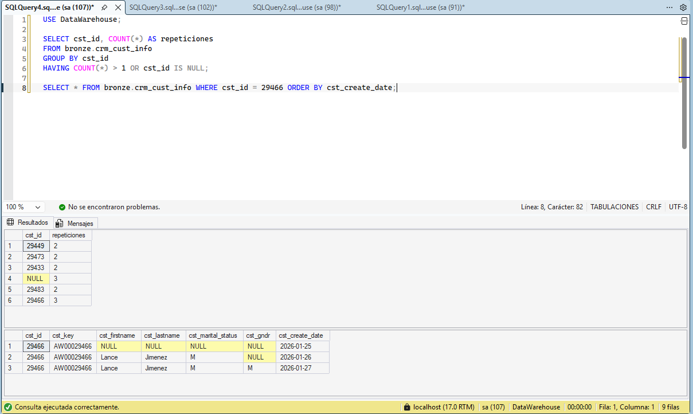

*Figura 10. Claves duplicadas o nulas en crm_cust_info y versiones del cliente 29466.*

En productos, 200 versiones tienen una fecha de fin anterior a la de inicio. Las fechas de fin del origen no son fiables, por lo que se regeneran a partir de la fecha de inicio de la versión siguiente.

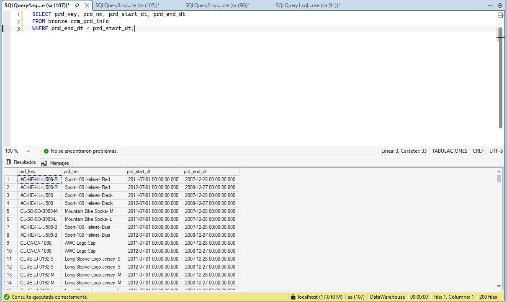

*Figura 11. Versiones de producto con fecha de fin anterior a la de inicio.*

En ventas hay 19 fechas de pedido que no tienen 8 dígitos (17 a cero, más `5489` y `32154`) y 38 líneas con importes nulos, negativos o que no cumplen ventas = cantidad × precio.

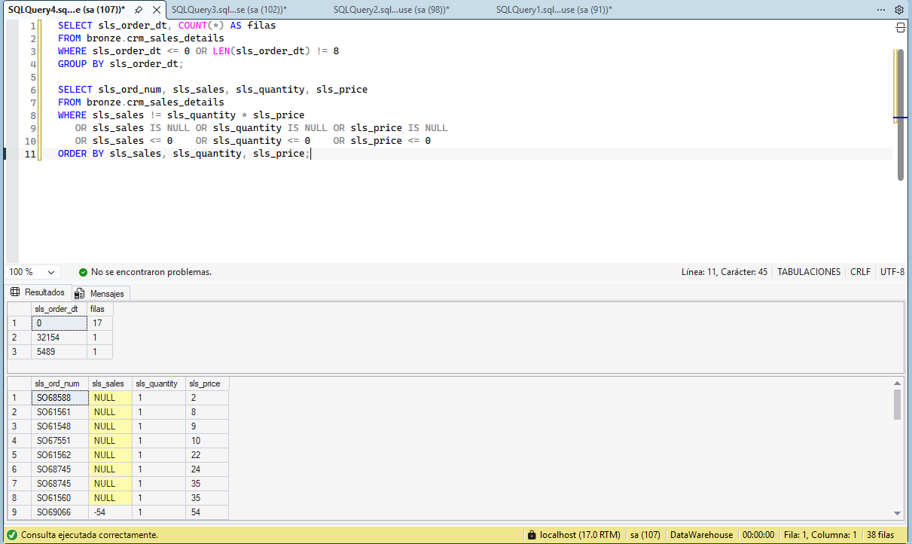

*Figura 12. Fechas de pedido no válidas e importes incoherentes en crm_sales_details.*

El género del ERP mezcla `M`, `F`, `Male`, `Female`, valores con espacios al final, cadenas vacías y nulos. Los países tienen el mismo problema: `US`, `USA` y `United States` para un mismo país, `DE` junto a `Germany`, vacíos y nulos.

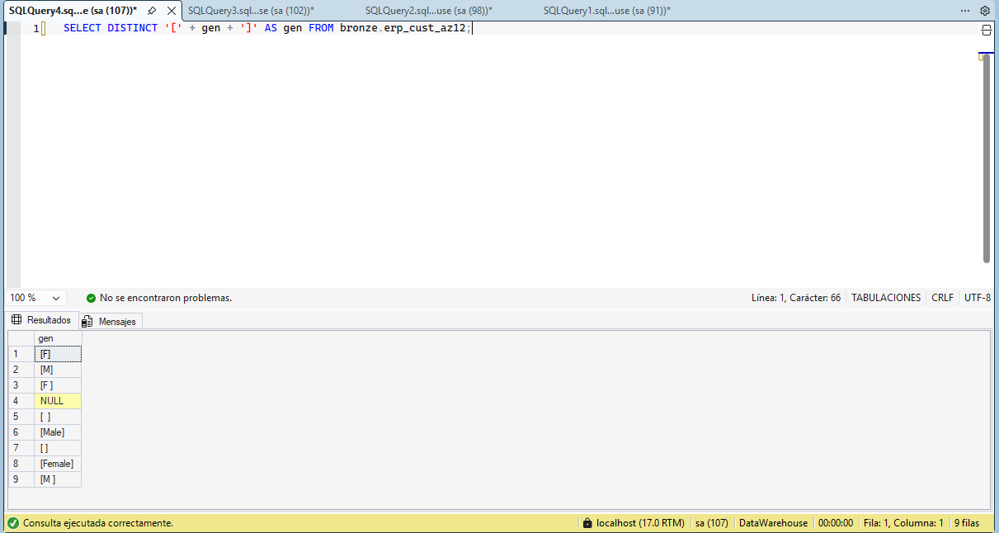

*Figura 13. Valores distintos de género en erp_cust_az12.*

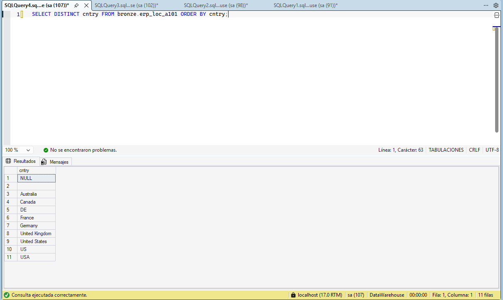

*Figura 14. Valores distintos de país en erp_loc_a101.*

Completé la detección con el resto de comprobaciones sobre Bronze. Al comparar textos con `!=`, SQL Server ignora los espacios finales, por lo que la comparación directa solo encuentra 15 nombres y 17 apellidos con espacios; comparando la longitud en bytes con `DATALENGTH` aparecen los 17 y 22 reales. Hay además 2 productos sin coste y las líneas de producto llegan con un espacio final.

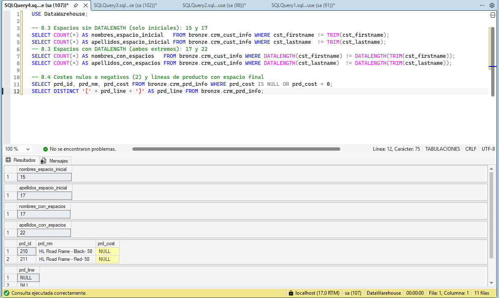

*Figura 15. Espacios en nombres y apellidos, costes nulos y valores de línea de producto.*

Las fechas de nacimiento incluyen valores futuros imposibles, como 2080, 2980 o 9999, junto a otras anteriores a 1924. El catálogo de categorías del ERP no tiene espacios sobrantes y el campo de mantenimiento solo toma `Yes` y `No`: es la única tabla que no necesita transformación.

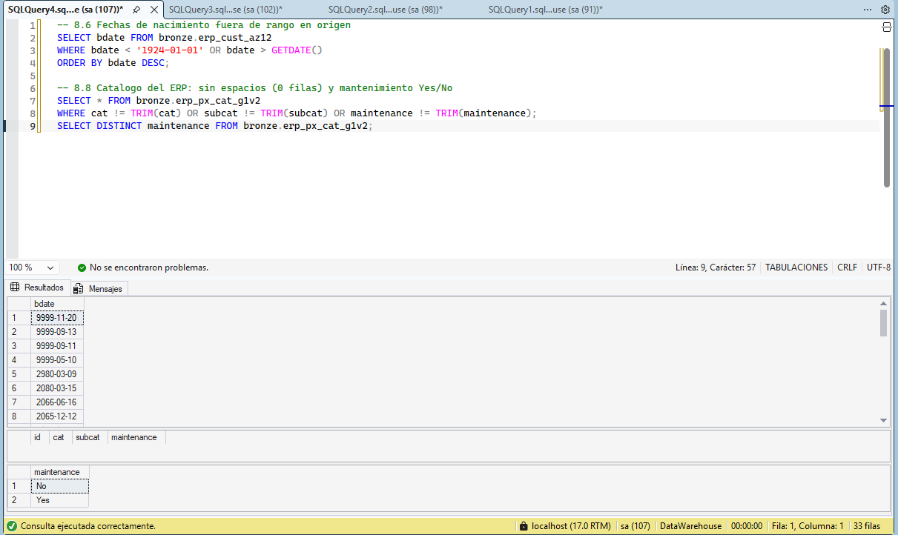

*Figura 16. Fechas de nacimiento fuera de rango y comprobaciones del catálogo del ERP.*

### 4.3 Transformaciones

Todas las reglas están en el procedimiento `silver.load_silver`. Las más relevantes son las siguientes.

| Tabla | Transformación |
|---|---|
| crm_cust_info | `ROW_NUMBER()` por `cst_id` ordenado por fecha descendente para quedarse con el último registro; descarte de `cst_id` nulos; `TRIM` en nombre y apellido; `S`/`M` a `Single`/`Married` y `F`/`M` a `Female`/`Male`, con `n/a` por defecto |
| crm_prd_info | `cat_id` a partir de los 5 primeros caracteres de `prd_key` con `-` cambiado por `_`; clave de producto sin esos 6 caracteres; coste nulo a 0; códigos de línea a texto; `prd_end_dt` calculada con `LEAD()` como el día anterior al inicio de la siguiente versión |
| crm_sales_details | Fechas `INT` a `DATE` con doble `CAST` y `NULL` para las no válidas; venta recalculada como cantidad × `ABS(precio)` si es nula, negativa o no cuadra; precio derivado como venta / cantidad si es nulo o negativo |
| erp_cust_az12 | Prefijo `NAS` eliminado de `cid`; fechas de nacimiento futuras a `NULL`; género estandarizado con `UPPER(TRIM())` |
| erp_loc_a101 | Guion eliminado de `cid`; `DE` a `Germany`, `US` y `USA` a `United States`, vacíos y nulos a `n/a` |
| erp_px_cat_g1v2 | Sin cambios: la tabla ya estaba limpia |

```sql
CAST(
    LEAD(prd_start_dt) OVER (PARTITION BY prd_key ORDER BY prd_start_dt) - 1
    AS DATE
) AS prd_end_dt
```

La resta de un día funciona porque en Bronze `prd_start_dt` es `DATETIME`, que admite restar un número entero interpretado en días; después el `CAST` elimina la hora. Con `DATE` habría sido necesario `DATEADD`. El procedimiento lleva también el `THROW;` en el `CATCH`, y corregí su mensaje de error, que en el original decía Bronze por un copia y pega.

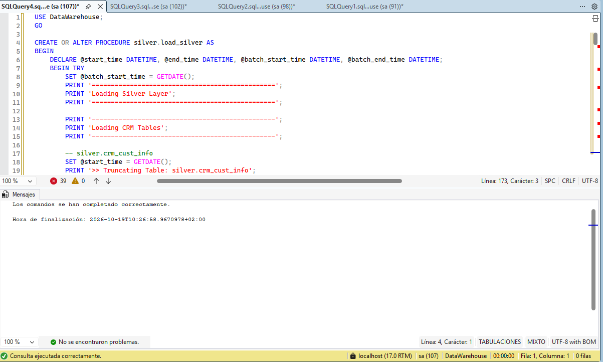

*Figura 17. Creación del procedimiento silver.load_silver.*

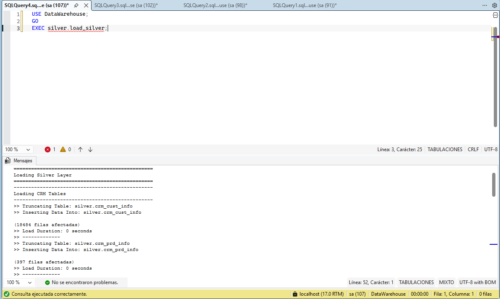

*Figura 18. Ejecución de silver.load_silver: 18.484 clientes y 397 productos insertados.*

Silver carga 18.484 clientes, la misma cifra que el enunciado: la fila que faltaba en Bronze era una de las que no tenían identificador y se descartan aquí.

### 4.4 Comprobaciones

Los países quedan estandarizados en siete valores, con las mismas cifras que el enunciado.

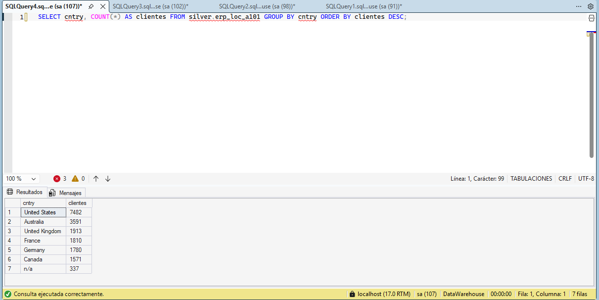

*Figura 19. Clientes por país en silver.erp_loc_a101.*

Al cruzar las categorías del CRM con el catálogo del ERP aparece `CO_PE` (pedales), que existe en el CRM pero no en el ERP. Lo mantengo así y se refleja en la capa Gold.

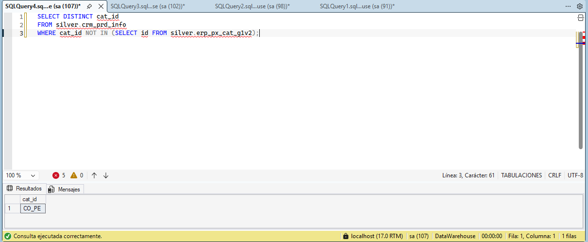

*Figura 20. Categoría del CRM sin correspondencia en el ERP.*

Por último ejecuté los controles de calidad del script `10_quality_checks_silver.sql`. Las consultas marcadas con resultado esperado vacío no devuelven filas, y las de revisión de valores muestran solo los valores estandarizados.

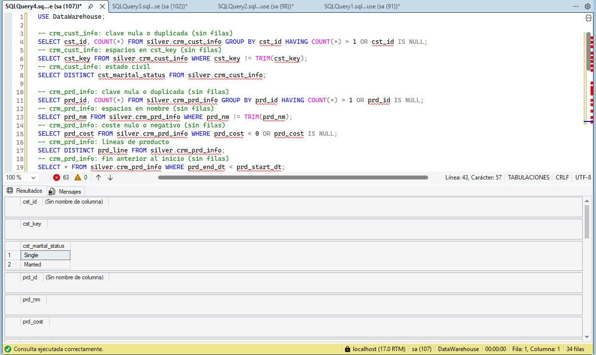

*Figura 21. Controles de calidad de la capa Silver.*

> El control de fechas de nacimiento devuelve 15 fechas anteriores a 1924. Es intencionado: solo se anulan las fechas futuras, que son imposibles; las muy antiguas son sospechosas pero posibles y se dejan para revisarlas con el responsable del ERP.

## 5. Capa Gold

### 5.1 Conflicto de género entre sistemas

El género existe en el CRM y en el ERP, y no siempre coincide: hay clientes `Female` en un sistema y `Male` en el otro, y muchos con `n/a` en el CRM que sí están informados en el ERP. La regla acordada es que el CRM es el sistema maestro y solo se usa el valor del ERP cuando el CRM tiene `n/a`.

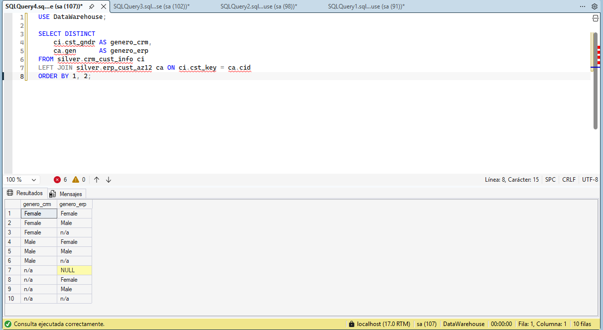

*Figura 22. Combinaciones de género entre CRM y ERP.*

### 5.2 Vistas del modelo en estrella

La capa Gold son tres vistas que se calculan sobre Silver en cada consulta, así que no hay que cargarlas:

| Vista | Contenido |
|---|---|
| gold.dim_customers | Cliente del CRM enriquecido con país, fecha de nacimiento y género del ERP mediante `LEFT JOIN`; clave subrogada `customer_key` con `ROW_NUMBER()` |
| gold.dim_products | Solo la versión vigente de cada producto (`prd_end_dt IS NULL`) con su categoría, subcategoría y mantenimiento; clave subrogada `product_key` |
| gold.fact_sales | Líneas de venta con las claves subrogadas de las dimensiones, las fechas y las métricas, en ese orden |

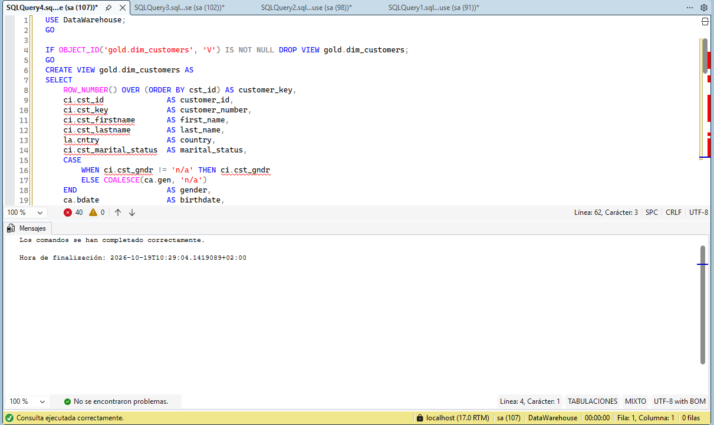

*Figura 23. Creación de las vistas de la capa Gold.*

La dimensión de productos tiene 295 productos y los 7 pedales aparecen sin categoría ni subcategoría, como consecuencia de `CO_PE`. La vista de hechos conserva las 60.398 líneas de Silver, sin perder ni duplicar ninguna.

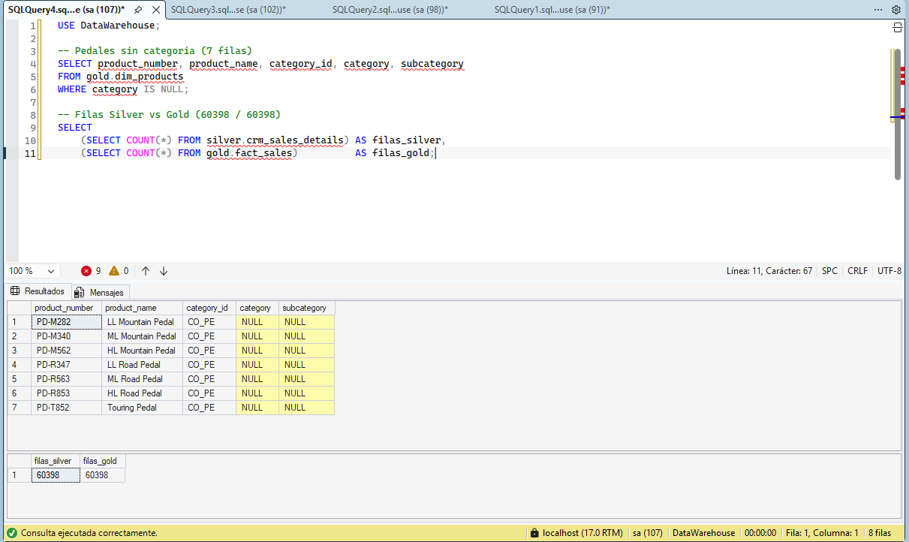

*Figura 24. Productos sin categoría y filas de ventas en Silver y en Gold.*

### 5.3 Integridad del modelo

El script de control de Gold comprueba que las claves subrogadas son únicas y que toda venta encuentra su cliente y su producto. La versión original de la última consulta une `gold.fact_sales` con las vistas de dimensión y no terminó tras más de tres minutos: `fact_sales` ya se construye a partir de esas vistas y, sin índices, SQL Server recalcula el `ROW_NUMBER()` de las dimensiones una y otra vez. Materialicé antes las vistas en tablas temporales y la misma comprobación tardó menos de un segundo.

```sql
SELECT customer_key INTO #cust FROM gold.dim_customers;
SELECT product_key  INTO #prod FROM gold.dim_products;
SELECT * INTO #fact FROM gold.fact_sales;

SELECT f.*
FROM #fact f
LEFT JOIN #cust c ON c.customer_key = f.customer_key
LEFT JOIN #prod p ON p.product_key  = f.product_key
WHERE p.product_key IS NULL OR c.customer_key IS NULL;
```

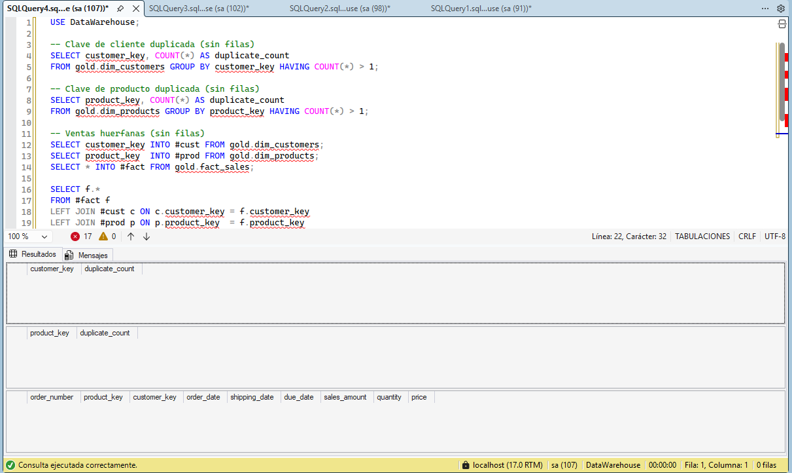

*Figura 25. Controles de calidad de la capa Gold: las tres consultas sin filas.*

## 6. Orquestación con SQL Server Agent

La carga completa se reduce a ejecutar `bronze.load_bronze` y después `silver.load_silver`; Gold no se carga porque son vistas. Para no depender de una ejecución manual creé un trabajo de SQL Server Agent, `DWH - Carga diaria`, con dos pasos encadenados y una programación diaria a las 06:00. El primer paso pasa al segundo solo si termina bien (`@on_success_action = 3`) y cualquier fallo detiene el trabajo con error (`@on_fail_action = 2`), de modo que Silver nunca transforma una carga de Bronze incompleta.

Hice tres ajustes respecto al script original:

| Ajuste | Motivo |
|---|---|
| `THROW;` en el `CATCH` de los dos procedimientos | Sin él, Agent da por buena una carga fallida y ejecuta Silver igualmente |
| `@@SERVERNAME` en `sp_add_jobserver` en lugar de `(local)` | Funciona igual en instancias por defecto y con nombre |
| Borrado previo de la programación `Diario 06:00` | Permite volver a ejecutar el script sin que falle por programación duplicada |

La primera ejecución del script devolvió el aviso de que SQLServerAgent no estaba en ejecución. El trabajo se había creado, pero el servicio del Agente estaba detenido. Comprobé que la edición lo incluye (`SERVERPROPERTY('Edition')` devuelve Standard Developer Edition), lo arranqué, di permiso de lectura sobre la carpeta de datos a la cuenta `NT SERVICE\SQLSERVERAGENT` con `icacls` y volví a ejecutar el script, esta vez sin avisos.

```powershell
icacls "C:\sql\dwh_project\datasets" /grant "NT SERVICE\SQLSERVERAGENT:(OI)(CI)R"
```

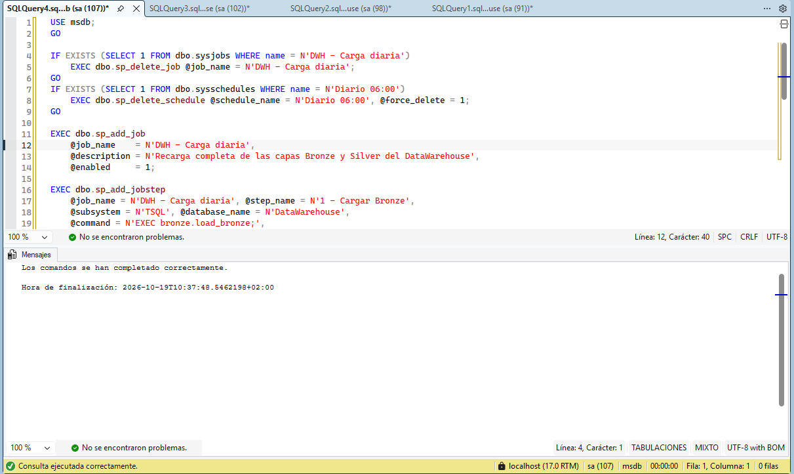

*Figura 26. Creación del trabajo con el Agente en ejecución.*

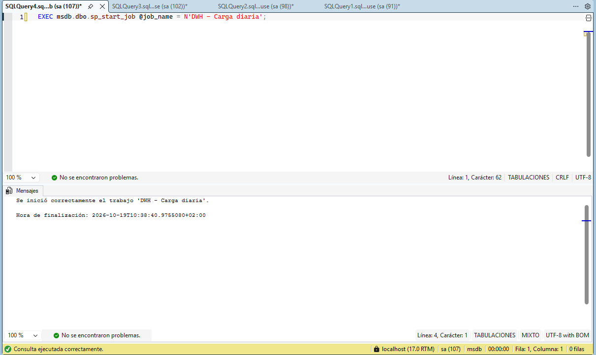

*Figura 27. Lanzamiento manual del trabajo con sp_start_job.*

En el historial, los dos pasos y el resumen del trabajo (`step_id = 0`) terminan en Correcto, ejecutados con la cuenta del servicio del Agente.

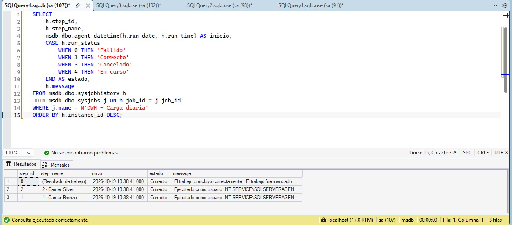

*Figura 28. Historial de ejecución del trabajo DWH - Carga diaria.*

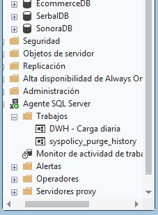

*Figura 29. Trabajo registrado en SQL Server Agent.*

## 7. Explotación de la capa Gold

Por el mismo motivo de rendimiento que en la sección 5.3, materialicé las tres vistas en tablas temporales en una misma sesión y lancé sobre ellas las consultas de negocio. Los resultados son idénticos a los de consultar las vistas, pero cada consulta responde al instante.

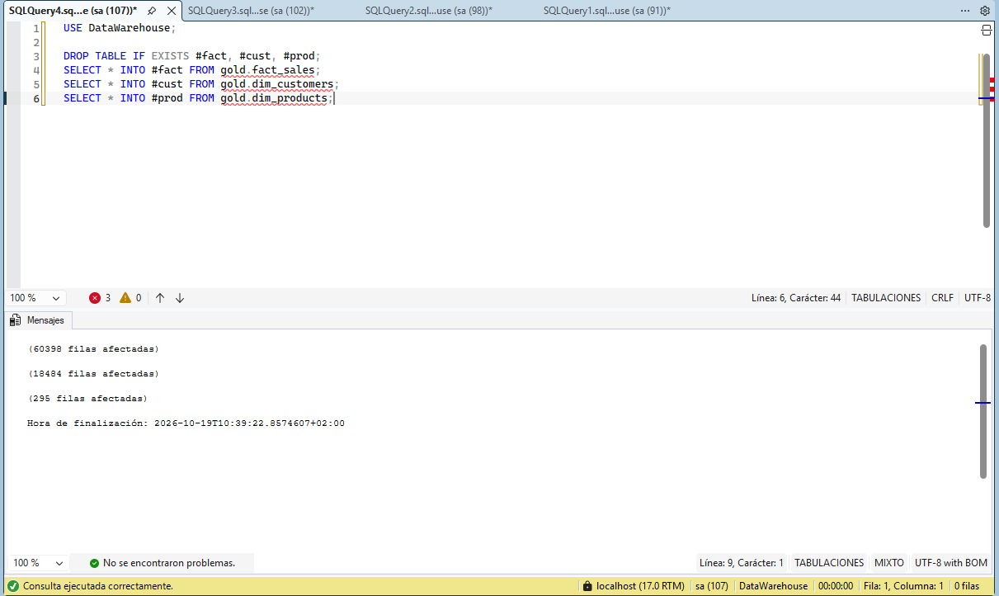

*Figura 30. Materialización de las vistas Gold: 60.398 ventas, 18.484 clientes y 295 productos.*

### 7.1 Indicadores principales

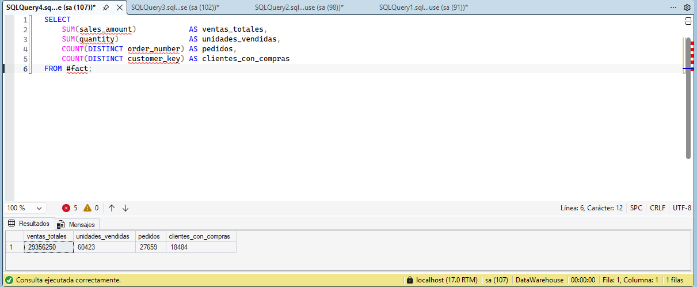

*Figura 31. Ventas totales, unidades, pedidos y clientes con compras.*

El negocio factura 29.356.250 con 60.423 unidades en 27.659 pedidos, y los 18.484 clientes han comprado al menos una vez.

### 7.2 Ventas por categoría

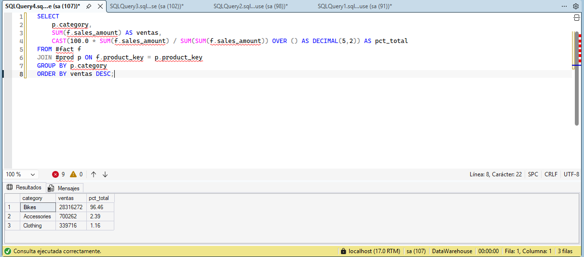

*Figura 32. Ventas por categoría y peso sobre el total.*

Las bicicletas suponen el 96,46 % de la facturación; accesorios y ropa apenas superan juntos el 3,5 %. La empresa depende casi por completo de una sola categoría. No aparece ninguna fila con categoría nula, lo que indica que los 7 pedales sin categoría no tienen ventas y el problema de `CO_PE` no altera estas cifras.

### 7.3 Ventas por país

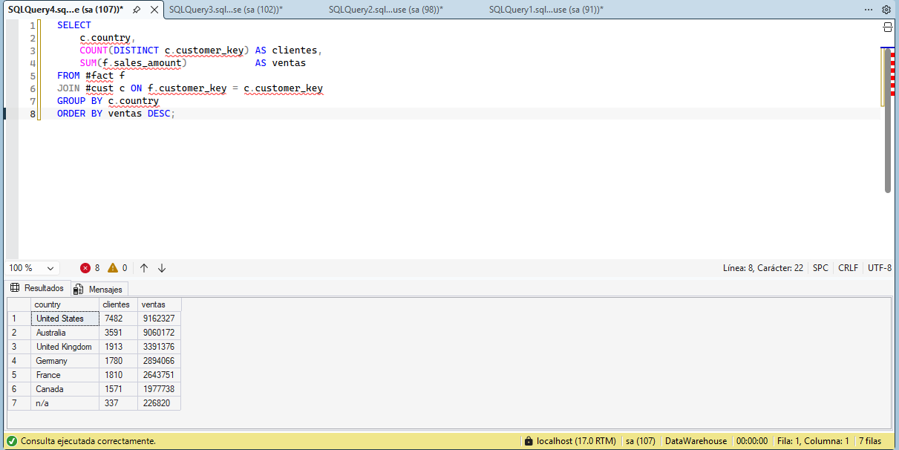

*Figura 33. Clientes y ventas por país.*

Estados Unidos y Australia facturan prácticamente lo mismo (9,16 y 9,06 millones), aunque Australia tiene menos de la mitad de clientes, lo que apunta a un ticket medio mucho mayor allí.

### 7.4 Ventas por año

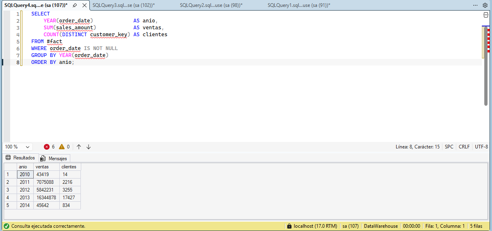

*Figura 34. Ventas y clientes por año de pedido.*

2010 y 2014 no son años completos: los datos empiezan a finales de diciembre de 2010 y terminan en enero de 2014, así que no se pueden comparar con el resto. Entre los años completos, 2013 casi triplica a 2012 y multiplica por cinco el número de clientes. La consulta excluye las 19 ventas sin fecha de pedido.

### 7.5 Productos más vendidos

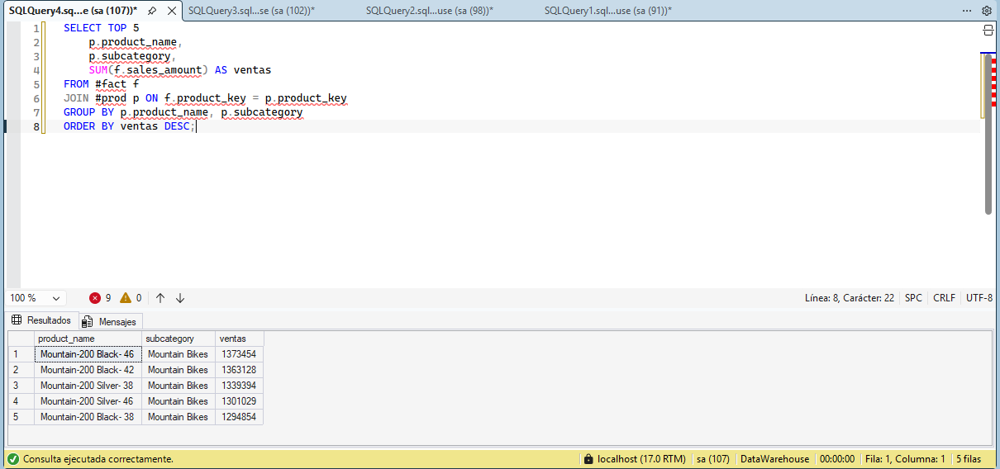

*Figura 35. Los cinco productos con más ventas.*

Los cinco primeros son variantes de la Mountain-200, encabezados por la Mountain-200 Black- 46 con 1.373.454.

### 7.6 Perfil de clientes

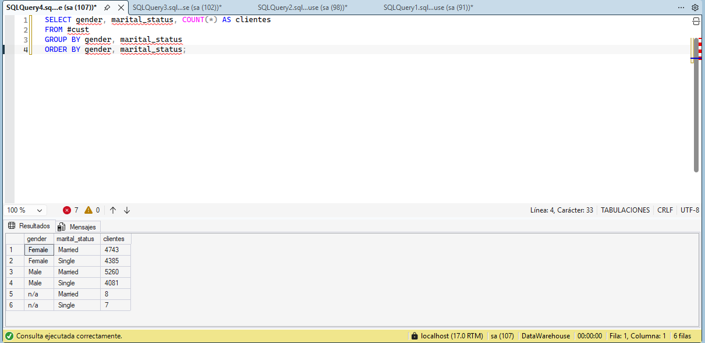

*Figura 36. Clientes por género y estado civil.*

Gracias a la integración con el ERP, el género desconocido pasa de 4.569 clientes en el CRM a solo 15. La base está equilibrada entre hombres y mujeres, con algo más de clientes casados que solteros.

### 7.7 Coherencia de importes

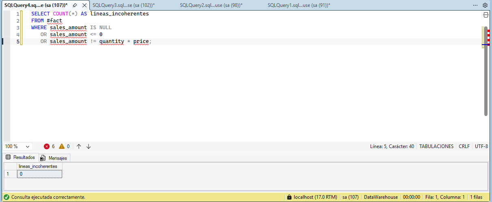

*Figura 37. Líneas con importe nulo, negativo o distinto de cantidad × precio.*

No queda ninguna línea incoherente, de modo que Finanzas puede usar `sales_amount` directamente sin comprobaciones propias.

## 8. Documentación del proyecto

Como pide la sección de documentación, preparé en la carpeta `docs/` el catálogo de datos de la capa Gold (`data_catalog.md`), las convenciones de nombres (`naming_conventions.md`) y cuatro diagramas generados con Graphviz, cuyo código fuente (`.dot`) acompaña a cada imagen.

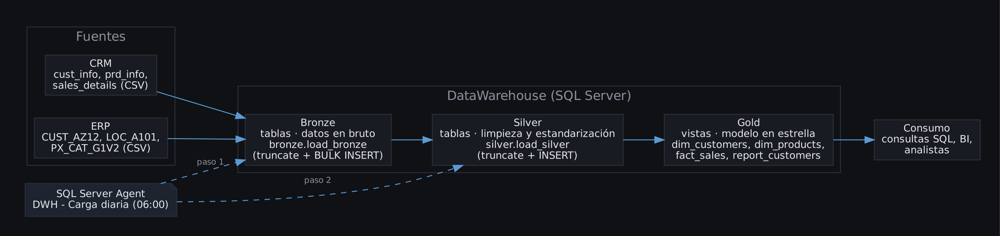

*Figura 38. Arquitectura del proyecto: fuentes, capas Medallón, consumo y orquestación.*

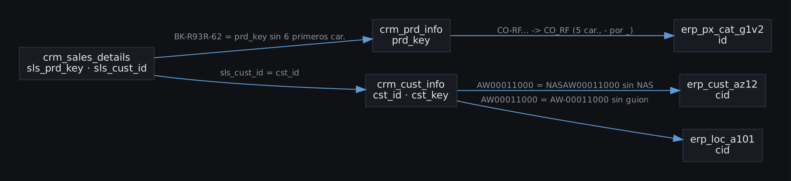

*Figura 39. Integración entre las tablas origen y transformación de claves necesaria en cada relación.*

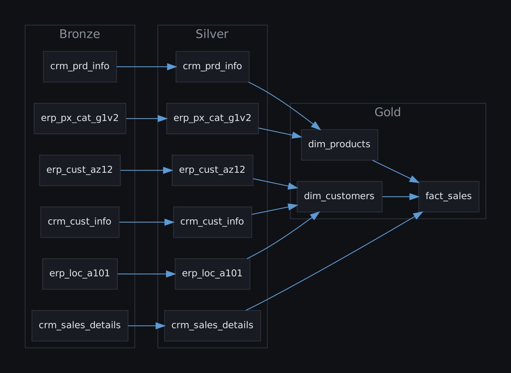

*Figura 40. Linaje de los datos desde Bronze hasta los objetos de negocio de Gold.*

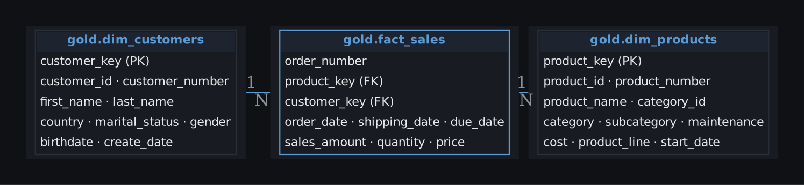

*Figura 41. Modelo en estrella de la capa Gold.*

En el catálogo uso el nombre real de la columna de mantenimiento de `gold.dim_products`, `maintenance`; en el catálogo original del proyecto figuraba como `maintenance_required`, un desajuste entre documentación y código.

## 9. Ejercicios propuestos

### 9.1 Ejercicio 1: ampliar los controles de calidad

Añadí a `10_quality_checks_silver.sql` seis comprobaciones, cada una con su comentario `Expectation`: espacios en nombre y apellido medidos con `DATALENGTH`, valores de género, ventas sin fecha de pedido, clientes de los dos ficheros del ERP que no existen en el CRM y categorías sin correspondencia en el catálogo.

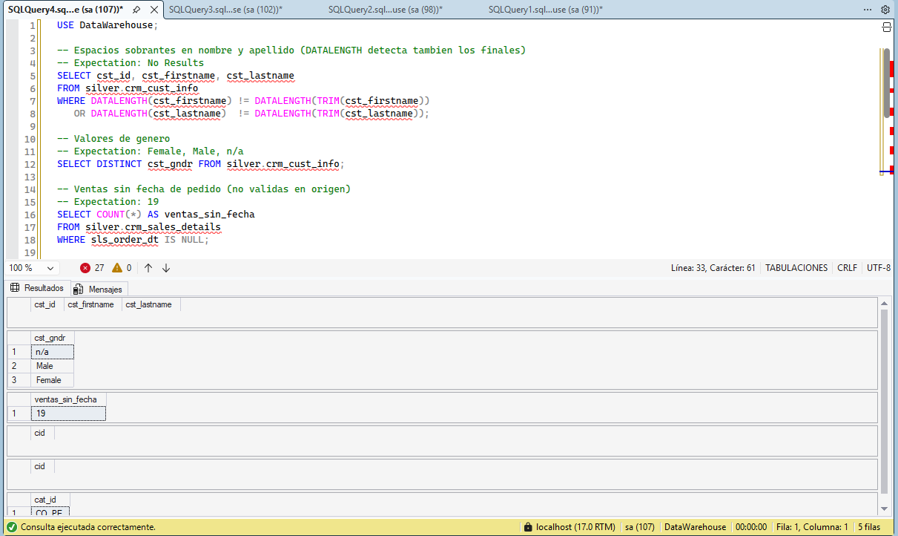

*Figura 42. Nuevos controles de calidad de la capa Silver.*

Todas dan lo esperado: ningún nombre con espacios, los tres valores de género, 19 ventas sin fecha, ningún cliente del ERP huérfano y `CO_PE` como única categoría sin correspondencia. En `14_quality_checks_gold.sql` añadí la consulta de productos sin categoría, que devuelve los 7 pedales.

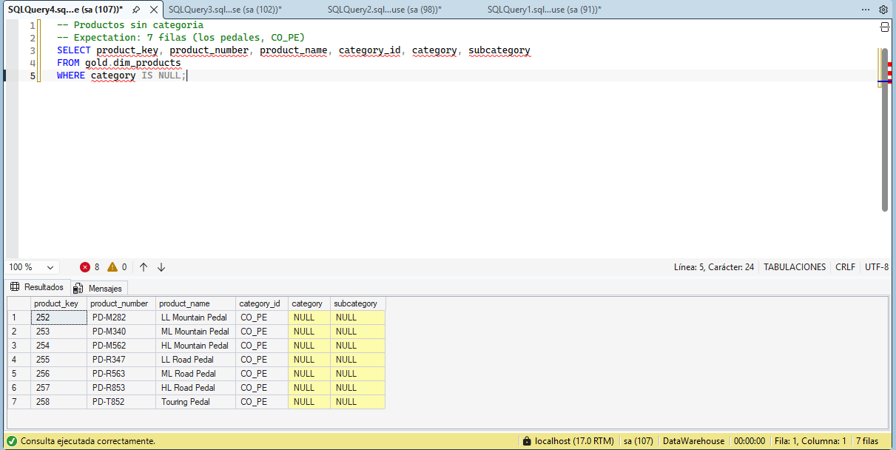

*Figura 43. Control añadido a la capa Gold: productos sin categoría.*

### 9.2 Ejercicio 2: registro de cargas

Creé la tabla `dbo.dwh_load_log` con la capa, la tabla, las filas cargadas, el inicio, el fin, el estado y el mensaje de error, y modifiqué `bronze.load_bronze` para insertar una fila por tabla. `@@ROWCOUNT` se guarda justo después del `BULK INSERT`, porque cualquier `SET` posterior lo reinicia. Si algo falla, el `CATCH` registra la tabla que se estaba cargando con estado `Error` antes de relanzar el error.

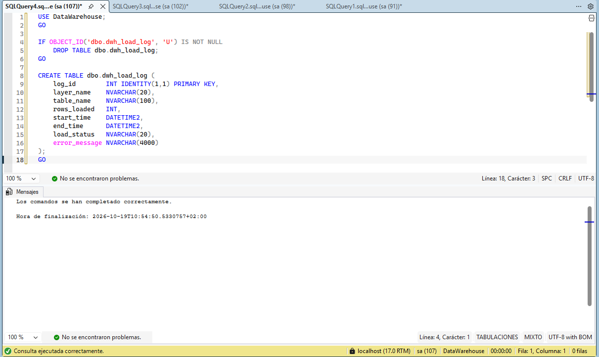

*Figura 44. Creación de la tabla dbo.dwh_load_log.*

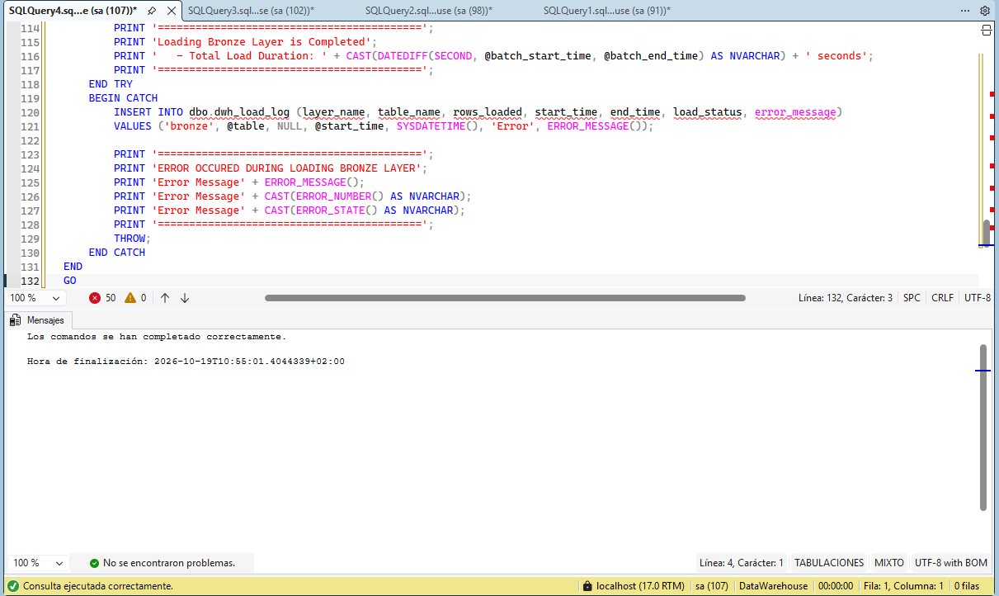

*Figura 45. Primera versión del procedimiento con registro en el CATCH.*

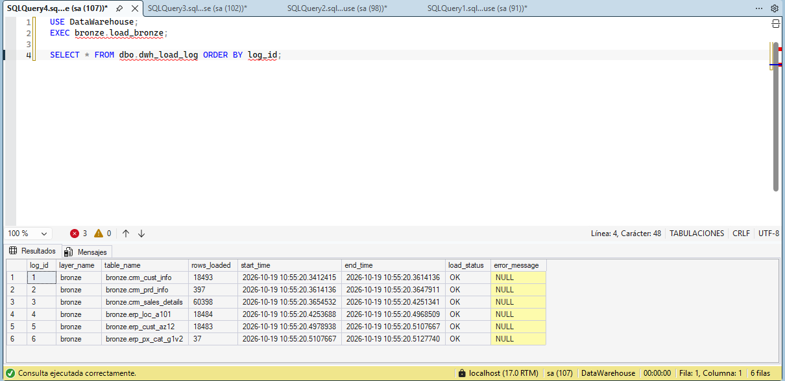

*Figura 46. Registro de una carga correcta: una fila por tabla con sus filas cargadas.*

Para probar el registro de errores renombré temporalmente `PX_CAT_G1V2.csv` y lancé la carga. Las cinco primeras tablas se registraron en OK, pero no apareció ninguna fila de Error para la sexta: el `CATCH` no llegó a ejecutarse.

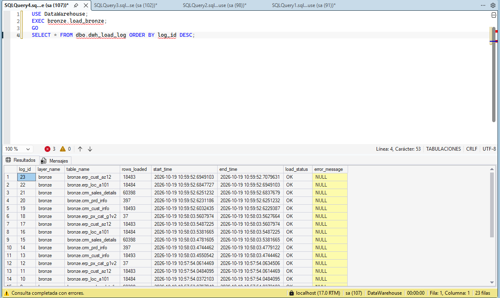

*Figura 47. Carga fallida sin fila de Error en el log: el CATCH no capturó el fallo.*

El motivo es que el error de fichero inexistente de `BULK INSERT` (Msg 4860) se produce al compilar la instrucción, y los errores de compilación que ocurren en el mismo nivel que el `TRY` no los captura su `CATCH`: suben directamente a quien llama. El procedimiento original tenía el mismo problema, aunque Agent sí detectaría el fallo gracias al `THROW;`. Lo resolví ejecutando el `TRUNCATE` y el `BULK INSERT` con `sp_executesql`, de modo que se compilan en un nivel inferior, y aproveché para recorrer las seis tablas con un bucle sobre una variable de tabla en lugar de repetir el bloque. `@@ROWCOUNT` se lee dentro del propio lote dinámico y se devuelve con un parámetro de salida.

```sql
SET @sql = N'TRUNCATE TABLE ' + @table + N';
             BULK INSERT ' + @table + N'
             FROM ''' + @path + N'''
             WITH (FIRSTROW = 2, FIELDTERMINATOR = '','', TABLOCK);
             SET @r = @@ROWCOUNT;';
EXEC sp_executesql @sql, N'@r INT OUTPUT', @r = @rows OUTPUT;
```

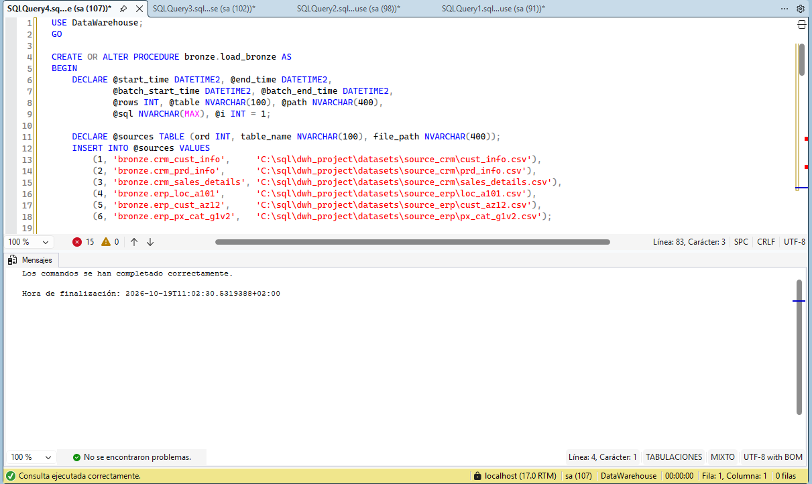

*Figura 48. Versión final del procedimiento con SQL dinámico.*

Con esta versión, al repetir la prueba el log pasó de 29 a 35 filas: las cinco tablas cargadas y la fila de Error de `erp_px_cat_g1v2`. Tras restaurar el fichero, una nueva carga añadió seis filas en OK. La versión final está en `sql/18_ej2_dwh_load_log.sql` y es la que ejecuta el trabajo de SQL Server Agent.

### 9.3 Ejercicio 3: ticket medio por país

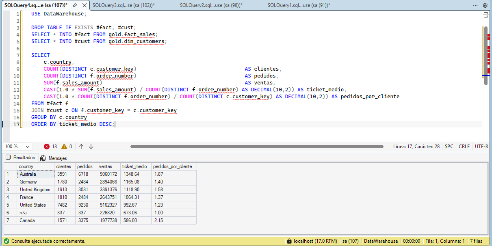

*Figura 49. Ticket medio por pedido y pedidos por cliente en cada país.*

Australia tiene el ticket medio más alto, 1.348,64 por pedido frente a 992,67 en Estados Unidos, y además sus clientes hacen más pedidos (1,87 frente a 1,23). La sospecha se confirma: factura casi lo mismo que Estados Unidos con menos de la mitad de clientes porque cada cliente compra más veces y gasta más en cada pedido. Canadá muestra el caso contrario: es el país con más pedidos por cliente (2,15) pero con el ticket más bajo (586,00).

### 9.4 Ejercicio 4: vista gold.report_customers

La vista devuelve una fila por cliente con edad, número de pedidos, ventas, primer y último pedido, antigüedad y segmento. Tomé estas decisiones de diseño:

| Decisión | Motivo |
|---|---|
| Edad exacta, restando un año si aún no se ha cumplido | `DATEDIFF(YEAR, ...)` solo cuenta cambios de año y sobrestima la edad antes del cumpleaños |
| Antigüedad como meses entre el primer y el último pedido | Medida hasta hoy, todos los clientes superarían 12 meses (los datos terminan en 2014) y la regla no distinguiría a nadie |
| Ventas agregadas desde `silver.crm_sales_details` y unidas una sola vez con `gold.dim_customers` | Evita anidar vistas sobre vistas, que en la sección 5.3 hizo que una consulta no terminara |
| Segmento: VIP si cumple las dos condiciones, Regular si cumple una, New si ninguna | Regla del enunciado, con más de 5.000 y más de 12 meses como umbrales estrictos |

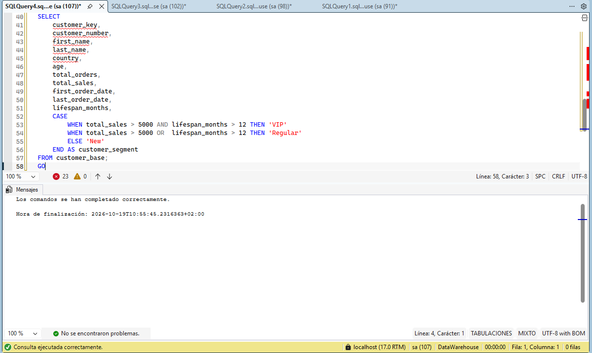

*Figura 50. Creación de la vista gold.report_customers.*


*Figura 51. Clientes con más ventas, reparto por segmento y comprobación de totales.*

La vista tiene 18.484 filas, una por cliente, y suma 29.356.250, exactamente lo mismo que `fact_sales`, así que la agregación no duplica importes. Hay 14.841 clientes New, 2.061 Regular y 1.582 VIP; los VIP son menos del 9 % de los clientes pero generan más de un tercio de las ventas.

### 9.5 Ejercicio 5: mensaje al responsable del ERP

> **Asunto: Categoría CO_PE ausente en el catálogo PX_CAT_G1V2**
>
> Hola,
>
> Al integrar el CRM con el ERP en el nuevo Data Warehouse he detectado que la categoría de producto CO_PE, que en el CRM agrupa los pedales, no existe en el catálogo de categorías del ERP (PX_CAT_G1V2), que contiene 37 categorías.
>
> Afecta a 7 productos vigentes: PD-M282, PD-M340, PD-M562, PD-R347, PD-R563, PD-R853 y PD-T852 (pedales de las líneas Mountain, Road y Touring). En la dimensión de productos aparecen con la categoría, la subcategoría y el indicador de mantenimiento vacíos.
>
> Ahora mismo no alteran las cifras porque esas versiones no tienen ventas registradas, pero cualquier venta futura de pedales saldría en los informes por categoría como un grupo sin nombre y no se sumaría a ninguna categoría.
>
> Te pido que des de alta CO_PE en PX_CAT_G1V2 con su categoría, subcategoría e indicador de mantenimiento, o que me confirmes si esos productos deben clasificarse en otra categoría existente. Te agradecería también una fecha aproximada para el cambio, para validarlo en la siguiente carga.
>
> Un saludo,
>
> Álvaro

## 10. Incidencias y decisiones

| Incidencia | Causa | Solución |
|---|---|---|
| Una fila menos en `crm_cust_info` y `erp_cust_az12` | Versión de los CSV distinta de la del enunciado | Ninguna; las cifras de Silver y Gold coinciden con las esperadas |
| Consulta de integridad de Gold sin terminar | Vista de hechos unida de nuevo con vistas de dimensión sin índices | Materializar las vistas en tablas temporales |
| Aviso de SQLServerAgent no en ejecución | Servicio del Agente detenido | Arrancar el servicio y repetir el script del trabajo |
| Fallos no detectables por Agent | El `CATCH` original no relanza el error | `THROW;` al final del `CATCH` |
| Fallo de fichero no registrado en el log | El error 4860 de `BULK INSERT` se produce al compilar y el `CATCH` del mismo nivel no lo captura | `BULK INSERT` con `sp_executesql` (ejercicio 2) |
| Mensaje de error de Silver que dice Bronze | Copia y pega en el script original | Mensaje corregido |

Dos observaciones quedan pendientes de comunicar a los responsables del ERP: la categoría `CO_PE` no existe en su catálogo, lo que deja 7 productos sin categoría en los informes, y hay 15 clientes con fecha de nacimiento anterior a 1924 que conviene revisar.

En un entorno productivo materializaría las dimensiones en tablas con una columna `IDENTITY`: las claves serían estables entre cargas y el problema de rendimiento de las vistas desaparecería.

## 11. Contenido de la entrega

| Ruta | Contenido |
|---|---|
| DWH_Medallon_SQLServer.pdf | Este documento |
| README.md | Versión en Markdown del documento, con las mismas figuras |
| img/ | Capturas numeradas en el orden de las figuras |
| sql/00 a 05 | Estructura de carpetas, base de datos, capa Bronze y su validación |
| sql/06 a 10 | Capa Silver: tablas, detección, procedimiento, comprobaciones y controles de calidad |
| sql/11 a 14 | Capa Gold: conflicto de género, vistas, comprobaciones y controles de calidad |
| sql/15 a 17 | Trabajo de SQL Server Agent, prueba e historial, y consultas de negocio |
| sql/18 a 20 | Ejercicios 2, 3 y 4; los controles del ejercicio 1 están añadidos en los scripts 10 y 14 |
| docs/ | Catálogo de datos, convenciones de nombres y diagramas con su código Graphviz |
